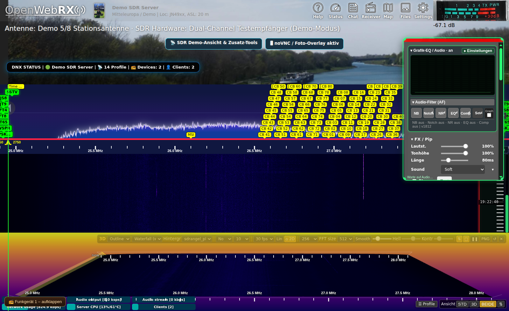
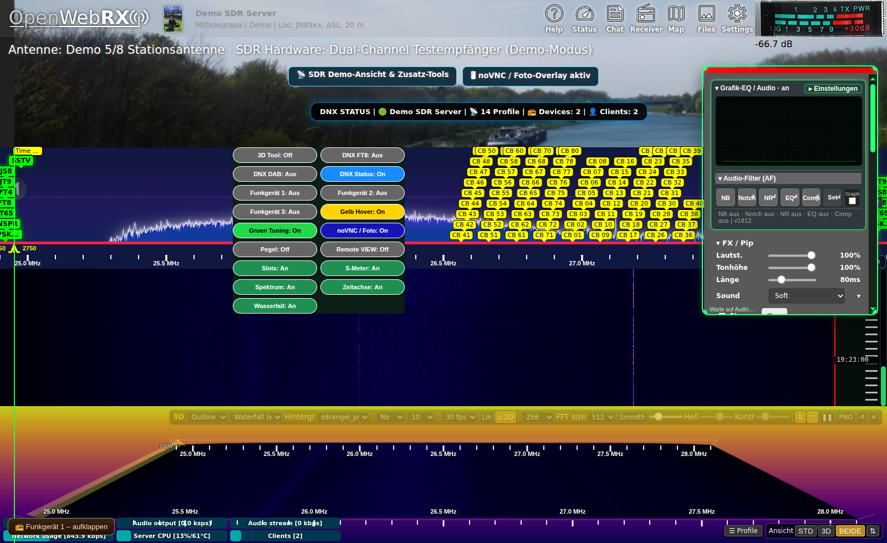

# DNX STATUS v1 (`v1.2.1`)

<!-- DNX-DISCLAIMER-START -->
> **Wichtiger Hinweis / Vollständige Distanzierung (Hobby-Mod-Mode)**
>
> - **Vollständige Distanzierung:** Ich distanziere mich in jeder Hinsicht vollständig vom Projekt **OpenWebRX / OpenWebRX+** sowie dessen Entwicklern und Betreibern. Es besteht keinerlei Verbindung, Zusammenarbeit, Prüfung, Befürwortung oder Partnerschaft.
> - **Keine öffentlichen/offiziellen OpenWebRX-Plugins (nur Mod-Mode):** Bei diesem Projekt handelt es sich ausdrücklich **nicht** um ein öffentliches oder offizielles Plugin von OpenWebRX, sondern ausschließlich um einen privaten, inoffiziellen **Mod-Mode** (Eigenmodifikation).
> - **Warum bewusst kein reines Browser-JavaScript (Mod-Mode-Architektur):** Viele Funktionen (z. B. serverseitige Speicherung, Konten-/Rollenverwaltung, Profil-Synchronisation, VNC-/websockify-Brücken, geschützte Schnittstellen, Docker-/Systemintegration und stabile UI-Anpassungen) lassen sich sauber und sicher nicht allein über simples Client-JavaScript umsetzen, ohne den OpenWebRX-Kern umzubauen oder Browsergrenzen zu umgehen. Deshalb setzt dieses Projekt bewusst auf getrennte Begleitmodule, Shell-Installer und Dienste im **Mod-Mode** statt alles künstlich in reines JavaScript zu pressen.
> - **Kein öffentlicher Support & keine Haftung:** Es gibt **keinen öffentlichen Support**, keine Garantie und keine Haftung. Nutzung, Installation und Anpassung erfolgen vollständig auf eigene Gefahr (immer vorher Backups anlegen und zunächst im eigenen Testsystem prüfen).
> - **Reines Hobbyprojekt – frei nutzbar, änderbar & verbreitbar:** Dieses Projekt entsteht ausschließlich aus reinem Hobby und Interesse am gemeinsamen Funk-/SDR-Hobby. Es steht ausdrücklich frei zur Verfügung und darf frei genutzt, weiterverbreitet, verändert und verbessert werden.
<!-- DNX-DISCLAIMER-END -->

> **Important Notice / Full Disassociation (Hobby Mod-Mode Only)**
>
> - **Full Disassociation:** I completely disassociate myself from **OpenWebRX / OpenWebRX+** and its developers/maintainers. There is no affiliation, endorsement, review, or partnership of any kind.
> - **No Official/Public OpenWebRX Plugins (Mod-Mode Only):** These files are **not** official or public OpenWebRX plugins, but purely unofficial hobby modifications (*mod-mode*).
> - **Why Not Everything in Pure Browser JavaScript:** Many features (server-side persistence, account/role management, profile syncing, VNC/websockify bridges, protected endpoints, and Docker/host integration) cannot be implemented cleanly or reliably in client-side JavaScript alone without modifying the OpenWebRX core or hitting browser/security limits. That is why this project intentionally uses separate companion scripts, services, and *mod-mode* hooks rather than forcing everything into pure JS.
> - **No Public Support & No Warranty:** There is **no public support**, no warranty, and no liability. Use entirely at your own risk (always create backups and verify on a test system first).
> - **Pure Hobby Project — Free to Use, Modify & Redistribute:** Created solely out of personal hobby interest in the radio/SDR hobby; freely available to use, share, modify, and improve.

<!-- DNX-PREVIEW-START -->
## Live-Vorschau & Galerie / Live Preview (`DNX STATUS v1`)



| Ansicht / View | Beschreibung / Description | Screenshot |
|---|---|---|
| **Aktive DNX-Statusleiste** | Schwebende Statusleiste (`DNX STATUS | Demo SDR Server | Profile | Devices | Clients`) sauber an der linken Position neben dem Schalter `DNX Status: On` |  |
| **Frei verschobene Statusleiste** | Statusleiste per Maus/Touch frei in den oberen Mittelbereich gezogen (`dnx_status_pos`) – Doppelklick stellt die Ausgangsposition wieder her |  |
<!-- DNX-PREVIEW-END -->

Schwebende Live-Statusleiste (`v1.2.1`) mit Echtzeitdaten aus `/status.json` (fallback `/static/static/settings.json`) und frei verschiebbarem `DNX Status: On/Off`-Button.

Floating live receiver status bar (`v1.2.1`) displaying server name, active profiles, SDR devices, and connected clients — freely draggable with persistent positioning and double-click reset.

## Neu in v1.2.1 / What's New

- **Frei verschiebbare Statusleiste (`dnx_status_pos`):** Die Status-Pill lässt sich jederzeit mit Maus oder Touch an jede Stelle des Fensters verschieben; Doppelklick setzt auf `20px, 20px` zurück.
- **Frei verschiebbarer Toggle-Button (`dnx.status.btn.pos.v1`):** `DNX Status: On/Off` kann bei Bedarf auch aus der Empfänger-Zeile gezogen und per Doppelklick wieder angedockt werden.
- **Universal-Installer (`install.sh`):** Unterstützt Docker (`CONTAINER=...`) sowie native Pfade (`TYP=normal PLUGINS=...`), inklusive `status`, `update`, `uninstall`.

## Dateien im Paket / Package Contents

| Datei | Ziel / Target | Zweck / Purpose |
|---|---|---|
| `install.sh` | Host (root) | Universal-Installer (`install`, `update`, `status`, `uninstall`) |
| `files/dnx_status.js` | `…/receiver/dnx_status_v1/dnx_status.js` | Status-Widget & verschiebbarer Button (`v1.2.1`) |
| `install-button-colors.sh` / `dnx_tool_button_colors.js` | Optional | Einheitliche Button-Statusfarben |
| `docs/` | — | 2 Funktionsscreenshots (`1600×980`) |

## Installation

```bash
chmod +x install.sh
sudo ./install.sh install
./install.sh status
sudo ./install.sh update
sudo ./install.sh uninstall
```

Backups: `/opt/dnx-status-v1-backups`.

---

## Verbindungen im DNX-Ökosystem


* **Verbindung zu `DNX-Styler`:** Im Styler schaltet `t_status` (`DNX Status`) diese Leiste ein/aus; zusätzlich lassen sich Statusleiste und Position (`◀ ▲ Mitte ▼ ▶` bzw. `dnx_status_pos`) über `#dnx-blk-receiver` zentral steuern und per `:8098/dnx/styler/std` vererben.
* **Verbindung zu `DNX-Receiver-Account-Control`:** Das Recht `dnx_status` in `:8095/api/me` regelt die Sichtbarkeit je Benutzerrolle.
